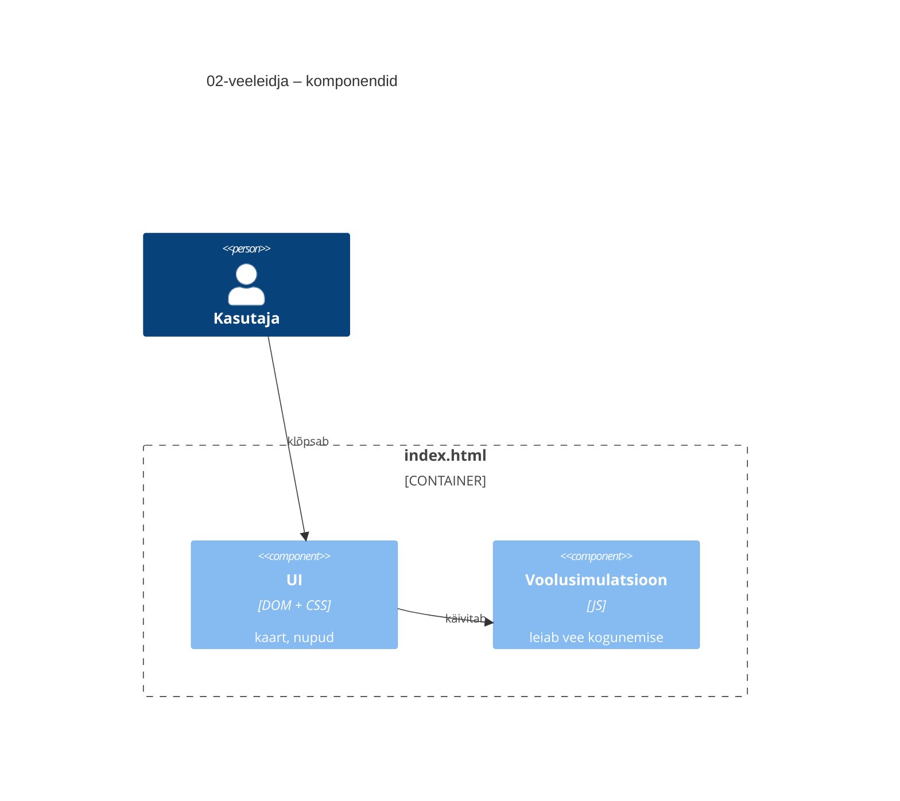

# C4 kaardid → docs/c4

Kaardid on **kontekst AI-agentidele**: lühikesed, faktilised, ilma täitesõnadeta. Iga kaart on alla 40 rea.

## Kaardid ja nende allikad

| Fail | C4 tase | Mermaid | Allikad (mille muutus käivitab uuendamise) |
|---|---|---|---|
| `docs/c4/L1-kontekst.md` | System Context | `C4Context` | `README.md`, `claude.md`, lisatud/kustutatud/ümbernimetatud `NN-*` kaustad |
| `docs/c4/L2-konteinerid.md` | Container | `C4Container` | `NN-*/README.md`, lisatud/kustutatud/ümbernimetatud failid `NN-*` kaustades |
| `docs/c4/L3-NN-nimi.md` (üks iga proovitöö kohta) | Component | `C4Component` | kogu kaust `NN-nimi/` |
| `docs/c4/L1-kontekst.svg`, `docs/c4/L2-konteinerid.svg` | pildid | – | renderdatud vastava `.md` Mermaid-plokist (vt „Pildid“) |
| `docs/c4/README.md` | indeks | – | loend kaartidest + üks rida iga kohta; uuenda, kui mõni kaart lisandub või kaob |

`NN-nimi` on proovitöö kaust (nt `02-veeleidja`). Proovitöö kaustu **ei muuda** – skill kirjutab ainult kausta `docs/c4/`.

## Tempel

Iga kaardi esimene rida:

```
<!-- c4-stamp commit=<lühike sha> sources="<allikad tühikuga eraldatult>" -->
```

`commit` on `git rev-parse --short HEAD` genereerimise hetkel.

## Töövoog

1. **Leia repo juur:** `git rev-parse --show-toplevel`. Kõik teed on juure suhtes.
2. **Kontrolli töökausta:** kui `git status --porcelain` näitab commitimata muudatusi allikates, siis tempel ei vastaks koodile. Paku variant (vt „Küsimused“): *„Commiti enne muudatused ja siis genereerin“* (soovitus) või *„Genereeri ikkagi, tempel = HEAD“*.
3. **Otsusta, mida uuendada:** iga olemasoleva kaardi kohta loe templist `commit`, siis:
   - L3: `git diff --name-only <commit> HEAD -- NN-nimi/` – tühi ⇒ jäta vahele.
   - L2: `git diff --name-status <commit> HEAD -- ':(glob)[0-9][0-9]-*/**'` – uuenda, kui on rida staatusega `A`/`D`/`R` või muutunud `README.md`.
   - L1: `git diff --name-status <commit> HEAD -- README.md claude.md ':(glob)[0-9][0-9]-*/**'` – uuenda, kui muutus `README.md`/`claude.md` või mõni `NN-*` kaust tekkis/kadus.
   - Kaart puudub või tempel puudub/vigane või commit pole kättesaadav (`git cat-file -e <commit>` ebaõnnestub) ⇒ genereeri.
   - Proovitöö kaust on kadunud ⇒ paku selle L3 kaardi kustutamist.
   - L1/L2 `.md` on ajakohane, aga `.svg` puudub ⇒ ainult renderda pilt (tekst jääb puutumata).
4. **Näita plaani enne kirjutamist:** lühike loend „uuendan: …, jätan vahele: … (muutusteta alates <sha>)“. Kui kõik on ajakohane, ütle seda ja lõpeta.
5. **Loe ainult vajalikke allikaid** (README-d esmalt, siis `index.html` jm). Suurte failide puhul otsi struktuuri (`<script>`, funktsioonid, klassid, `localStorage`, `fetch`, välised CDN-id), mitte loe kõike.
6. **Kirjuta kaardid** allpool oleva malli järgi, iga kaart uue templiga.
6a. **Joonista L1 ja L2 pildid** (vt „Pildid“), kui vastav `.md` sel korral uuenes või `.svg` puudub.
7. **Valideeri:** iga kaart algab templiga, sisaldab täpselt ühte ` ```mermaid ` plokki, on < 40 rea, ID-d on unikaalsed, igal `Rel`-il on mõlemad otsad defineeritud.
8. **Raporteeri** ühe-kahe reaga: mis uuenes, mis jäi vahele. Ära commiti, kui kasutaja ei palu.

## Pildid

Ainult L1 ja L2 saavad pildi; L3 jääb ainult tekstiks.

```
"$(git rev-parse --show-toplevel)"/.claude/skills/c4-kaardid/render.sh docs/c4/L1-kontekst.md docs/c4/L2-konteinerid.md
```

- Skript võtab `.md`-st esimese ` ```mermaid ` ploki ja kirjutab sama nimega `.svg` samasse kausta (`@mermaid-js/mermaid-cli` npx kaudu, versioon skriptis fikseeritud).
- Kasutab süsteemi Chrome'i (macOS vaikimisi asukoht või `CHROME_PATH`); muidu laadib puppeteer Chromiumi alla.
- Pildil templit pole: pilt kehtib sama commiti kohta kui tema `.md`. Seepärast renderda alati pärast `.md` uuendamist, mitte eraldi.
- **Vaata pilt üle:** `qlmanage -t -s 1400 -o <scratchpad> docs/c4/<kaart>.svg` teeb PNG-eelvaate, loe see Read-tööriistaga. Kui nool läbib kasti või silt kattub tekstiga, muuda elementide järjekorda ja renderda uuesti. Mermaid paigutab elemendid deklareerimise järjekorras ruudustikku, praktikas **2 elementi rea kohta** (`$c4ShapeInRow` suuremat ei anna): järjesta nii, et iga `Rel` läheks naaberlahtrisse (kõrvale või otse alla), mitte üle teise kasti.
- Kui renderdamine ebaõnnestub (puudub Node/Chrome, võrguühendus, süntaksiviga), jäta `.md` alles, näita viga ja paku kasutajale lahendust; ära kustuta vana `.svg`-d vaikselt.
- `docs/c4/README.md` indeksis viita piltidele kaardi rea juures.

## Küsimused: paku variant, küsi kinnitust

Kui midagi on ebaselge (nt kas väline CDN on eraldi süsteem, mis on komponendi piir ühe-failises rakenduses, kuidas nimetada kasutajat), **ära küsi lahtist küsimust**. Kasuta `AskUserQuestion`:

- esimene variant = sinu ettepanek, sildiga „(Soovitatud)“, kirjelduses lühike põhjendus;
- 1–2 alternatiivi;
- kasutaja saab „Other“ kaudu ise täiendada või muuta.

Koonda küsimused ühte kutsesse (max 4). Kinnitatud otsused kirjuta kaardi `Otsused` reale, et järgmisel korral sama asja uuesti ei küsitaks.

## Kaardi mall

````markdown
<!-- c4-stamp commit=abc1234 sources="02-veeleidja/" -->
# L3 · 02-veeleidja



- Sisend/väljund: …
- Olek: … (nt localStorage võti `x`, või „puudub“)
- Välised sõltuvused: … / „puuduvad“
- Otsused: … (kasutaja kinnitatud tõlgendused)
````

Reeglid:
- Faktid ainult koodist/README-st; kui pole kindel, küsi (vt ülal), ära oleta.
- 3–7 elementi diagrammi kohta; L3-s ainult olulised komponendid, mitte iga funktsioon.
- Täpid: max 4, igaüks üks rida. Ära korda seda, mida diagramm juba näitab.
- L1: kasutaja + iga proovitöö kui `System` + välised süsteemid (kui on).
- L2: iga proovitöö kui `System_Boundary` oma konteineritega (tavaliselt üks `Container` = `index.html` brauseris; lisa `ContainerDb` ainult päris salvestuse puhul, nt localStorage).
