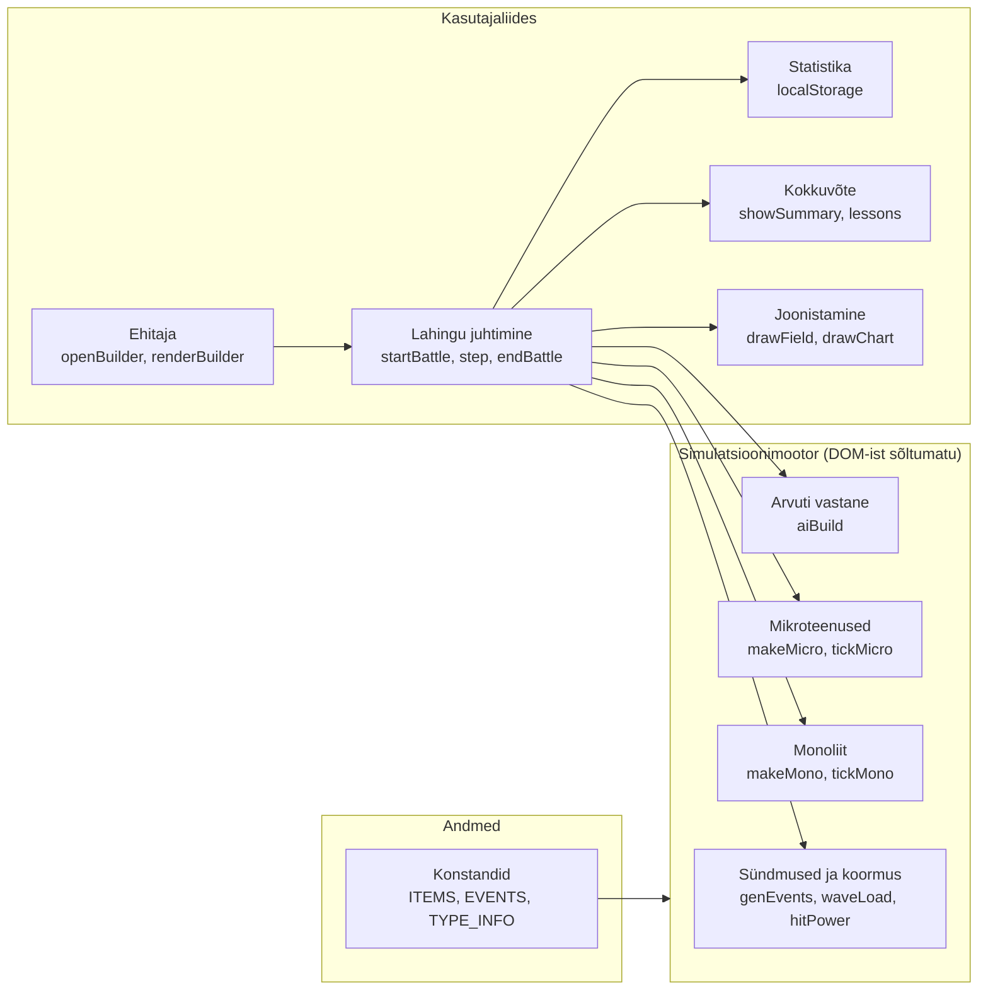
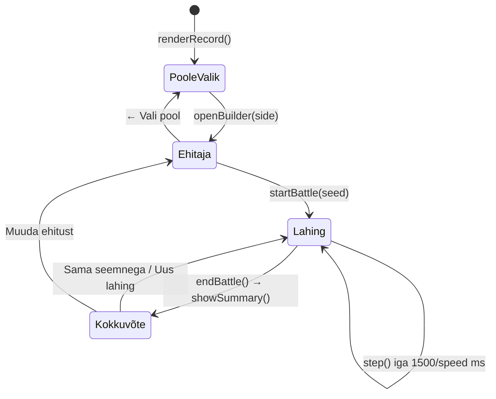

# Tehniline dokumentatsioon

Programm on üks fail `index.html` (umbes 1270 rida). Sees on HTML-märgistus, CSS ja üks `<script>`-plokk puhta JavaScriptiga. Raamistikke, teeke ega ehitusprotsessi pole.

Koodis pole klasse. See on jagatud **funktsioonide plokkideks**. Olekut hoiavad tavalised JS-objektid, mida simulatsioonifunktsioonid muudavad. Plokid on koodis eraldatud kommentaaridega `// ---------- Nimi ----------`.

## 1. Üldine ülesehitus



Kõige tähtsam disainiotsus on, et **simulatsioon on visuaalist lahus**. Funktsioonid `tickMono` ja `tickMicro` ei puutu DOM-i ega canvas'it. Nad saavad sisendi, muudavad oma poole olekut ja tagastavad tulemuse. Seetõttu saab mootorit käivitada ka Node.js-is, ilma brauserita. Nii testisin arenduse ajal ka tasakaalu: 9 strateegiapaari × 300 seemet.

## 2. Ekraanid ja mängutsükkel

Lehel on kolm ekraani (`section`) ja kokkuvõtte ülekate. Funktsioon `show(id)` näitab korraga ainult üht ekraani.



Lahingus töötab **kaks sõltumatut tsüklit**:

1. **Simulatsioonitsükkel.** `schedule()` kutsub `setTimeout` abil välja `step()`. Ühe laine kestus on `1500 / speed` ms. Paus peatab ainult selle tsükli.
2. **Animatsioonitsükkel.** `frame()` jookseb `requestAnimationFrame` abil umbes 60 korda sekundis ja joonistab lahinguvälja ning osakesed (nooled, sädemed) uuesti. See ainult kuvab olekut ega muuda seda.

Nupp ⏭ kutsub `step(false)` tsüklis välja kuni lõpuni, ilma animatsioonita.

## 3. Ühe laine käik: `step(animate)`

```
wave++
ev    = game.events[wave]            // selle laine sündmus või null
load  = waveLoad(wave, rng, ev)      // sama koormus mõlemale poolele
rm    = tickMono(mono, load, ev, ...)
rs    = tickMicro(micro, load, ev, ...)
mono.hp  -= rm.failed * 0.6 + hitPower(rs)
micro.hp -= rs.failed * 0.6 + hitPower(rm)
hist.push(...)                       // graafiku jaoks
if animate: osakesed, bänner, HUD, graafik
if hp <= 0 või wave >= 30: endBattle()
```

**Kahju valem:**

```
hitPower(r) = r.served × 0.18 × clamp(1.3 − r.lat / 300, 0.5, 1.2)
```

Teenindatud päring on rünnak vastase vastu. Kiire vastus (näiteks 30 ms) annab kordaja umbes 1.2, aeglane (≥ 240 ms) 0.5–1.0. Nii saab monoliit oma väiksest latentsusest päris eelise.

**Võitja:** suurema `hp`-ga pool. Kui vahe on alla 0.5, on viik.

## 4. Determinism ja juhuslikkus

Juhuarvude generaator `mulberry32(seed)` on 32-bitine ja annab sama seemnega alati sama jada. Kasutusel on kolm sõltumatut voogu:

| Voog | Seeme | Kasutus |
|---|---|---|
| Arvuti ehitus | `seed ^ 0x9e3779b9` | `aiBuild` valib strateegia |
| Sündmused | `seed + 1` | `genEvents` koostab kõigi 30 laine sündmuste kava ette |
| Simulatsioon | `seed + 2` | koormuse müra ja sündmuste sihtmärgid (millist teenust tabatakse) |

Kuna `tickMono` ja `tickMicro` kutsutakse alati samas järjekorras ja kasutavad sama voogu, kordub sama seemne ja sama mängija ehitusega lahing täpselt. Osakeste animatsioon kasutab `Math.random()`, aga see ei mõjuta tulemust.

## 5. Andmestruktuurid

### Konstandid

| Nimi | Sisu |
|---|---|
| `MAX_WAVES = 30`, `START_HP = 1000`, `SLA = 300`, `BUDGET = 100` | Mängu põhiparameetrid |
| `TYPES` | Mikroteenuste ahela järjekord: `['gw', 'auth', 'core', 'db']` |
| `TYPE_INFO` | Iga teenuse ikoon, nimi ja ühe eksemplari maht (200 / 150 / 110 / 120) |
| `ITEMS.mono`, `ITEMS.micro` | Poe kaubad: `{ id, icon, name, tech, desc, cost, max }` |
| `EVENTS` | Sündmuste ikoonid, nimed ja kirjeldused |
| `CAUSE_NAMES` | Ebaõnnestumise põhjuste nimed kokkuvõtte jaoks |
| `AI_STRATEGIES` | Arvuti strateegiad: nimi ja ostude prioriteedijärjekord |

### Ehitus (`build`)

See on objekt, mille võtmed on kaupade `id`-d ja väärtused ostetud kogused. Näiteks `{ cpu: 3, db: 2, cache: 1, hard: 0, replica: 1, monitor: 1 }`. Selle loob `emptyBuild(side)` ja maksumuse arvutab `spent(side, b)`.

### Monoliidi olek (`makeMono`)

```js
{
  kind: 'mono', b: build, hp: 1000, stats,
  lock: 0,          // mitu lainet on andmebaas veel lukus
  util: 0,          // viimase laine koormatus (joonistamiseks)
  replicas: [ { stab: 100, down: 0, deploying: false }, ... ]
}
```

`stab` on stabiilsus 0–100 ja `down` näitab, mitu lainet on koopia veel maas.

### Mikroteenuste olek (`makeMicro`)

```js
{
  kind: 'micro', b: build, hp: 1000, stats,
  inst: { gw: [ {h, down, auto, deploying}, ... ], auth: [...], core: [...], db: [...] },
  backlog: 0,          // järjekorras ootavad päringud
  retryNext: 0,        // retry-tormi lisakoormus järgmisele lainele
  partition: null,     // äralõigatud teenuse tüüp
  partT: 0,            // mitu lainet jagunemine veel kestab
  dbLock: 0,
  autoAdded: 0, pendingScale: null,   // autoscaler
  cascadeRecent: false, cascadeLat: 0, // eelmise laine kaskaadi mõju
  util: { gw, auth, core, db }
}
```

`h` on eksemplari tervis 0–100. `auto: true` tähendab, et eksemplari lisas autoscaler.

### Statistika (`newStats`)

Kokkuvõtte jaoks kogutakse: `served`, `failed`, `latSum` / `latN` (keskmine latentsus), `causes` (põhjus → päringute arv), `peakLoad`, `downWaves`, `retryLoad`, `retried`, `autoscaled`, `buffered`, `cascades`.

### Mängu olek (`game`)

Selle loob `startBattle`. Seal on `seed`, `aiSide`, `aiStrategy`, `builds`, `rng`, `events`, `mono`, `micro`, `wave`, `hist` (graafiku ajalugu), `over`, `winner`, `timer`, `seen` (toimunud sündmuste tüübid õppetundide jaoks) ja `last` (viimase laine tulemused HUD-i jaoks).

Globaalsed kasutajaliidese muutujad on `playerSide`, `playerBuild`, `speed`, `paused`, `chartMode`, `particles` ja `C` (CSS-ist loetud värvid).

## 6. Simulatsioonimudel

Mõlemat poolt kirjeldab sama põhimõte: **maht → teenindatud / ebaõnnestunud → latentsus → ajalõpud → kahju süsteemile → krahhid**.

Latentsuse valem on mõlemal poolel sama ja meenutab järjekorrateooriat (M/M/1): latentsus kasvab järsult, kui koormatus läheneb 100%-le.

```
lat = baas / max(0.07, 1 − koormatus × 0.95)
ajalõpu osa = clamp((lat − 300) / 600, 0, 0.8)   // see osa teenindatud päringutest loetakse ebaõnnestunuks
```

### 6.1 `tickMono(m, load, ev, rng, log)`

| Samm | Loogika |
|---|---|
| Maht | `monoCaps(b)`: koopia maht `160 + 70·cpu`, andmebaas `(220 + 100·db) / (1 − 0.15·cache)`, baaslatentsus `25 − 5·cache` ms |
| Sündmused | **Balrog**: lukk `max(1, 3 − ⌊db/2⌋)` lainet, andmebaasi maht ×0.35 ja latentsus +120 ms. **Mäluleke**: kõigi tornide stabiilsus −40 (Silmaga −15). **Deploy**: mitme koopiaga läheb üks koopia `deploying`, ühe koopiaga on maht ×0.4. Viga: kõigi stabiilsus −35. **Võrgu jagunemine** ei mõjuta. |
| Teenindamine | `eff = min(töötavad koopiad × maht, andmebaasi maht)`. `served = min(load, eff)` ja ülejääk on `failed`. |
| Põhjus | Kõik maas → `krahh`. Deploy → `deploy`. Andmebaasilukk on kitsaskoht → `andmebaasilukk`. Muul juhul `ülekoormus`. |
| Stabiilsus | Kui `stress > 0.9`: `stab −= (min(stress, 2.5) − 0.9) × 110 × (1 − 0.2·hard)`. Kui `stress < 0.8`: `stab += 10`. |
| Krahh | `stab ≤ 0` → `down = 3` (Silmaga 2). Taaskäivitusel `stab = 60` (külmkäivitus). |

### 6.2 `tickMicro(s, load, ev, rng, log)`

| Samm | Loogika |
|---|---|
| Autoscaler | Kui eelmine laine otsustas skaleerida (`pendingScale`), lisatakse nüüd uus eksemplar. Viivitus on 1 laine. |
| Sündmused | **Balrog**: andmebaasi maht ×0.6 kaheks laineks. **Mäluleke**: ühe juhusliku eksemplari tervis −60. **Võrgu jagunemine**: juhuslik teenus (Auth, Core või DB) kaheks laineks, maht ×0.3 või mesh'iga ×0.75. **Deploy**: juhuslik teenus. Mitme eksemplari korral läheb üks `deploying`, muidu on maht ×0.5. Viga: selle teenuse eksemplaride tervis −45. |
| Retry-torm | Eelmise laine `retryNext` lisatakse koormusele |
| Maht | `microCaps`: iga tüübi töötavad eksemplarid × maht. DB-l `/(1 − 0.25·cache)`. Süsteemi maht on `min` üle nelja tüübi ja pudelikael on vähima mahuga tüüp. |
| Teenindamine | `incoming = load + backlog`. `served = min(incoming, sysCap)`. Ülejäägist läheb kuni `150·queue` järjekorda, ülejäänu on `failed`. |
| Teenuste koormus | Gateway näeb kogu sissetulekut. Järgmised näevad kuni Gateway mahtu. Järjekorra olemasolul piiratakse nende koormus `sysCap × 0.95` peale, nii et järjekord kaitseb teenuseid. |
| Latentsus | Iga teenuse latentsuse summa (8 ms, DB 10 ms, cache'iga vähem) + 4 võrguhüpet × (8 + 2·mesh) ms + järjekorras ootamine `backlog / sysCap × 250` + eelmise laine kaskaadi viide 150 ms |
| Kordused | **Backoff'iga**: `min(0.6·failed, vaba maht)` päästetakse. **Ilma**: `0.4·failed` tuleb järgmisse lainesse lisakoormuseks. |
| Tervis | Valem on sama mis monoliidil, aga iga tüübi kohta eraldi ja ilma Raudmüürideta. Taastumine +12 lainega. |
| Kaskaad | Leitakse probleemsed teenused, mis kukuvad või on ära lõigatud. Kui sügavaim neist ei ole Gateway ja **circuit breaker puudub**, saavad kõik ülesvoolu eksemplarid −25 tervist ning järgmises laines on latentsus +150 ms ja põhjus `kaskaadtõrge`. Breaker'iga logitakse ainult „circuit breaker avanes”. |
| Krahh | `h ≤ 0` → `down = 1`. Konteiner on maas üks laine ja käivitub uuesti `h = 70`-ga. |
| Autoscaler | Kui pudelikaela koormatus on üle 0.85, lisatud on alla 3 eksemplari ja teenus ei ole ära lõigatud, siis `pendingScale = pudelikael`. |

### 6.3 Koormus ja sündmused

- **`waveLoad(w, rng, ev)`**: `(120 + 7·w) × juhuslik 0.88–1.12`. DDoS ×1.7, Must reede ×2, Hobbitide pidu ×0.6.
- **`genEvents(rng)`** koostab sündmuste kava enne lahingut:
  - deploy lainetes 6, 12, 18 ja 24, kusjuures vea tõenäosus on kummalgi poolel eraldi 30%;
  - Must reede lainetes 20–21;
  - ülejäänud lainetes alates 3. lainest on juhusliku sündmuse tõenäosus 32%. Kaalud: DDoS, Balrog, võrgu jagunemine ja mäluleke 2, pidu 1.

## 7. Funktsioonide teatmik

### Abifunktsioonid

| Funktsioon | Ülesanne |
|---|---|
| `mulberry32(a)` | Tagastab seemnega juhuarvude generaatori (0 ≤ x < 1) |
| `clamp(v, a, b)` | Piirab väärtuse vahemikku |
| `$(id)` | Lühend `document.getElementById` jaoks |
| `fmt(n)` | Ümardab ja vormindab arvu eesti stiilis |
| `emptyBuild(side)` | Tühi ehitus: kõik kogused 0 |
| `spent(side, b)` | Ehituse hind kullas |
| `newStats()` | Tühi statistikaobjekt |
| `addCause(S, c, n)` | Lisab `n` ebaõnnestumist põhjusele `c` |

### Simulatsioon

| Funktsioon | Ülesanne |
|---|---|
| `monoCaps(b)` | Arvutab monoliidi mahu, andmebaasi mahu, koopiate arvu ja baaslatentsuse |
| `makeMono(b)` | Loob monoliidi algoleku |
| `tickMono(m, load, ev, rng, log)` | Simuleerib monoliidi üht lainet. Tagastab `{ served, failed, lat, load }`. |
| `makeMicro(b)` | Loob mikroteenuste algoleku |
| `microCaps(s, deployHalf)` | Iga teenusetüübi praegune maht (arvestab krahhe, deploy'd, lukku ja jagunemist) |
| `microBaseLat(b)` | Mikroteenuste baaslatentsus eelvaate jaoks |
| `tickMicro(s, load, ev, rng, log)` | Simuleerib mikroteenuste üht lainet. Tagastab `{ served, failed, lat, load }`. |
| `genEvents(rng)` | Koostab kogu lahingu sündmuste kava |
| `waveLoad(w, rng, ev)` | Laine koormus |
| `hitPower(r)` | Kui palju poole tulemus vastast kahjustab |
| `aiBuild(side, rng)` | Valib strateegia ja ostab prioriteetide järgi, kuni raha jätkub. Teine ring täidab ülejäägi. |
| `describeBuild(side, b)` | Ehituse lühikirjeldus ikoonidena logi jaoks |

### Kasutajaliides ja lahingu juhtimine

| Funktsioon | Ülesanne |
|---|---|
| `show(id)` | Näitab ühte kolmest ekraanist |
| `openBuilder(side)` | Avab ehitaja. Kui pool vahetub, alustab tühja ehitusega. |
| `renderBuilder()` | Joonistab poe nimekirja ja eelarve |
| `renderPreview()` | Arvutab ja näitab ehituse eelvaadet (maht, pudelikael, latentsus) |
| `startBattle(seed)` | Koostab arvuti ehituse, sündmuste kava ja algolekud ning käivitab tsükli |
| `schedule()` | Planeerib järgmise `step()` vastavalt kiirusele ja pausile |
| `step(animate)` | Ühe laine täielik käik (vt jaotis 3) |
| `endBattle(animate)` | Määrab võitja, salvestab ajaloo ja avab kokkuvõtte |
| `log(w, cls, text)` | Lisab logirea (kuni 250 rida) |
| `updateHud()` | Uuendab eluribasid ja laine näitajaid |
| `updateControls()` | Uuendab pausi ja kiiruse nuppude olekut |

### Kokkuvõte

| Funktsioon | Ülesanne |
|---|---|
| `showSummary()` | Koostab tulemuste tabeli ja põhjuste jaotuse |
| `lessons(g)` | Koostab statistika ja toimunud sündmuste põhjal kummalegi poolele kuni 5 õppetundi. Probleemid on järjestatud kahju suuruse järgi ja tugevused (negatiivse kaaluga) tulevad nende järel. |

### Statistika

| Funktsioon | Ülesanne |
|---|---|
| `loadRecord()` / `saveRecord(r)` | Loeb või salvestab `localStorage` võtme `mvm-record` kujul `{ mono: [võidud, kaotused, viigid], micro: [...] }`. On `try/catch`-iga kaitstud, nii et privaatrežiimis mäng ei kuku. |
| `renderRecord()` | Näitab ajalugu poolevaliku ekraanil |

### Joonistamine (canvas)

| Funktsioon | Ülesanne |
|---|---|
| `readColors()` | Loeb CSS-muutujad objekti `C`. Teema vahetusel loetakse need uuesti. |
| `fit(cv, ctx)` / `resizeCanvases()` | Kohandab canvas'e suuruse ja `devicePixelRatio` järgi (terav pilt Retina ekraanil). Käivitub `ResizeObserver`-iga. |
| `zones()` | Lahinguvälja tsoonid: monoliit 0–36%, keskväli, mikroteenused 58–100% laiusest |
| `spawnVolley(rm, rs)` | Loob laine tulemuste põhjal nooled (teenindatud) ja sädemed (ebaõnnestunud) |
| `frame(now)` | `requestAnimationFrame`-tsükkel |
| `drawField(now, dt)` | Joonistab keskvälja, mõlemad pooled ja osakesed |
| `drawMono(...)` | Tornid (polügoon), helendav silm, olekuikoonid ja stabiilsusribad |
| `drawMicro(...)` | Teenuste veerud, võrgujooned (liikuv katkendjoon), eksemplarid tervise ja olekuga ning lisade rida |
| `drawChart()` | Joongraafik valitud näitaja (`hp`, `served`, `lat` või `failed`) kohta koos SLA joone ja Musta reede vöödiga |
| `bar(...)`, `healthColor(f)` | Väike edenemisriba ja selle värv (roheline → kollane → punane) |

## 8. Kujundus

- Värvid on CSS-muutujates (`--mono`, `--micro`, `--gold` jne). Hele teema on pärgamenditoonides, tume teema `prefers-color-scheme: dark` kaudu.
- Canvas loeb samad värvid `getComputedStyle` abil, nii et joonised järgivad teemat.
- Kitsal ekraanil (alla 900 px ja alla 600 px) lähevad paneelid üksteise alla.
- Kõik pildid on emoji või canvas'ele joonistatud kujundid. Väliseid faile ega pilte pole.

## 9. Laiendamine

- **Uus täiendus:** lisa kirje `ITEMS.mono` või `ITEMS.micro` alla ja selle mõju funktsiooni `monoCaps` / `tickMono` või `microCaps` / `tickMicro`. Ehitaja, eelvaade ja arvuti näevad seda automaatselt. Arvuti ostab seda siis, kui lisad selle `AI_STRATEGIES` prioriteetidesse.
- **Uus sündmus:** lisa kirje `EVENTS` alla, `genEvents` kogumisse ja mõlemasse `tick*` funktsiooni `if (ev.type === '...')` haru.
- **Tasakaal:** põhilised kruvid on `hitPower` kordajad, `0.6` ebaõnnestumiste trahv, mahud `TYPE_INFO` ja `monoCaps` juures ning kaupade hinnad. Pärast muutmist tasub simulatsiooniplokk (`Konstandid` kuni `Arvuti vastane`) Node'is läbi lasta paljude seemnetega. See osa ei vaja brauserit.
