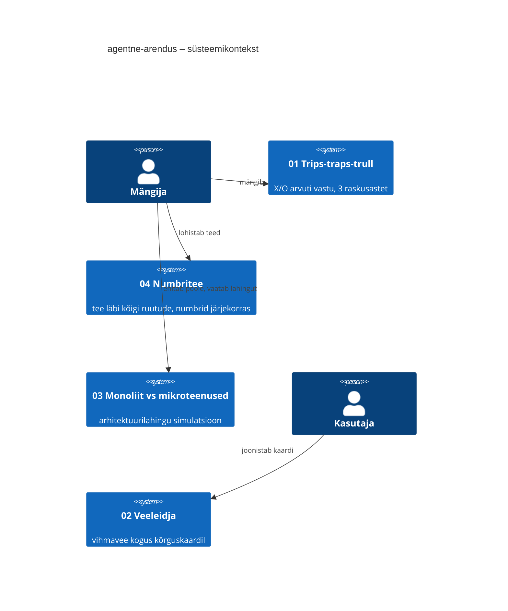

<!-- c4-stamp commit=e57f8fe sources="README.md claude.md NN-*/" -->
# L1 · Süsteemikontekst

- Repo: Industry62 agentse arenduse koolitus; iga proovitöö = eraldi kaust `NN-nimi/` oma README-ga.
- Proovitööd on omavahel sõltumatud; ühe töö kallal töötades ära muuda teiste kaustu.
- Välised süsteemid: puuduvad (serverit, API-sid ega CDN-e pole).
- Otsused: persoon igal tööl oma rolliga (01, 03, 04 Mängija; 02 Kasutaja).
