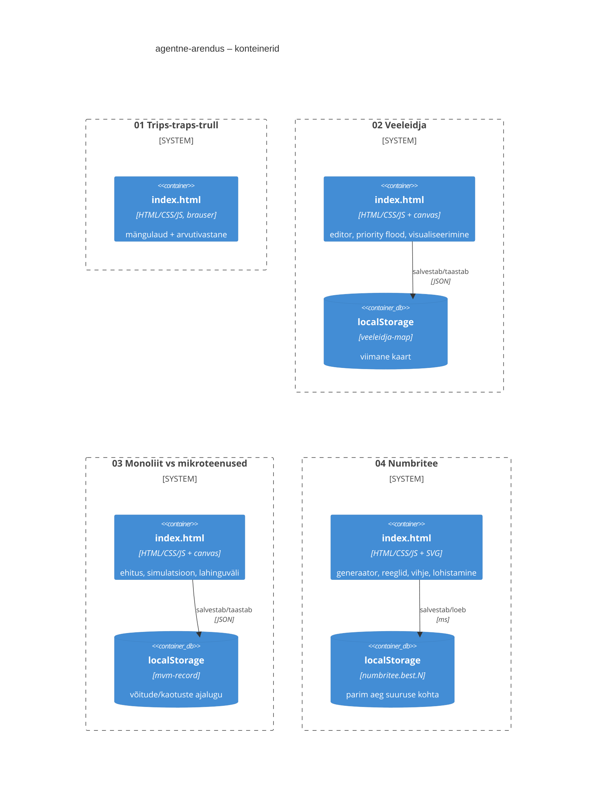

<!-- c4-stamp commit=e57f8fe sources="NN-*/README.md NN-*/ (failide lisandumine/kadumine)" -->
# L2 · Konteinerid

- Kõik on üks fail, ilma raamistiku, build-sammu ja serverita; käivitus = ava `index.html`. 04 `test.mjs` (Node) on arendaja testid, mitte konteiner.
- Kõik toetavad tumedat teemat.
- 03 dokumentatsioon (`JUHEND.md`, `DOKUMENTATSIOON.md`) ei ole konteiner, vt L3.
- Otsused: Markdown-dokke L2-le ei kanta.
