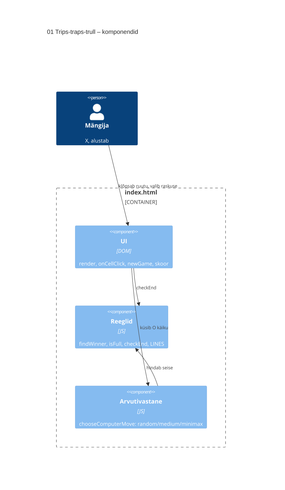

<!-- c4-stamp commit=2d6b5c5 sources="01-esimene-proov/" -->
# L3 · 01-esimene-proov

- Olek: muutujad `board`, `gameOver`, `score` mälus; skoor kaob lehe uuesti laadimisel.
- Raskus: Lihtne = juhuslik, Keskmine = võida/blokeeri, Võitmatu = minimax.
- Välised sõltuvused: puuduvad.
- Otsused: persoon = Mängija.
