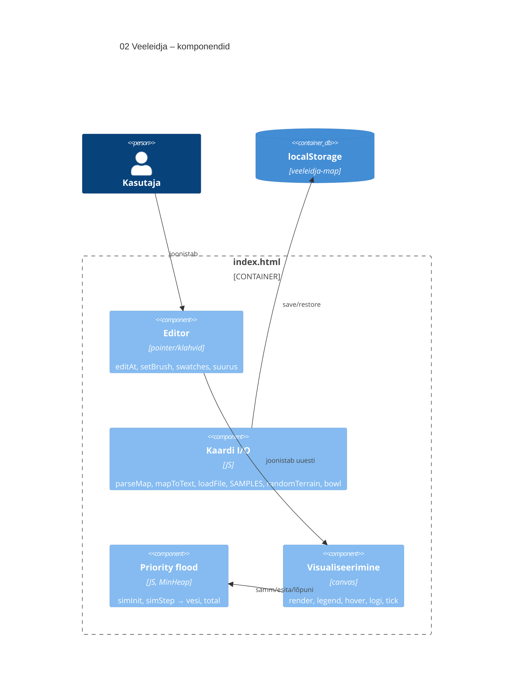

<!-- c4-stamp commit=2d6b5c5 sources="02-veeleidja/" -->
# L3 · 02-veeleidja

- Failivorming: üks kaardirida faili rea kohta, kõrgused 0–99 tühikuga; max 100×100.
- Algoritm O(N log N), ilma rekursioonita; olekuks globaalsed `W`, `H`, `grid`.
- Test konsoolist: `Veeleidja.solve("9 9 9\n9 1 9\n9 9 9")` → 8.
- Otsused: persoon = Kasutaja.
