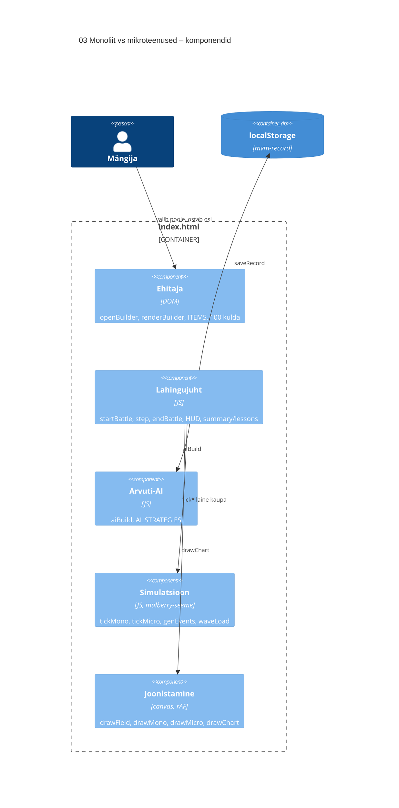

<!-- c4-stamp commit=2d6b5c5 sources="03-monoliit-vs-mikroteenused/" -->
# L3 · 03-monoliit-vs-mikroteenused

- Detailid: `DOKUMENTATSIOON.md` (andmestruktuurid, mudel, funktsioonide teatmik, laiendamine); mängureeglid: `JUHEND.md`.
- Determinism: sama seemne ja ehitusega lahing kordub täpselt; 30 lainet, SLA 300 ms.
- Otsused: Markdown-dokid ainult viitena; persoon = Mängija.
