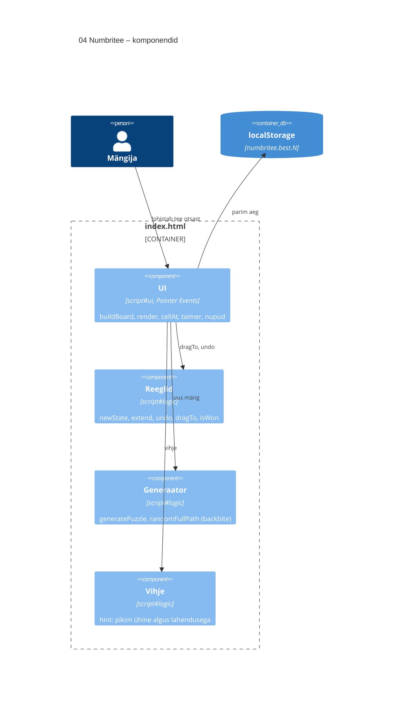

<!-- c4-stamp commit=e57f8fe sources="04-numbritee/" -->
# L3 · 04-numbritee

- Olek: muutumatu `state` (path, reached, undos, hints, won, started); iga käik tagastab uue objekti.
- Testid: `node test.mjs` laeb DOM-ita `script#logic` ploki `node:vm`-iga (23 testi); `rng` parameetrina (`seededRng`).
- localStorage: ms, ainult vihjeteta võit; vea korral mäng töötab ilma. Välised sõltuvused: puuduvad.
- Otsused: persoon = Mängija; spec ja plaan kaustas `04-numbritee/docs/plans/`.
